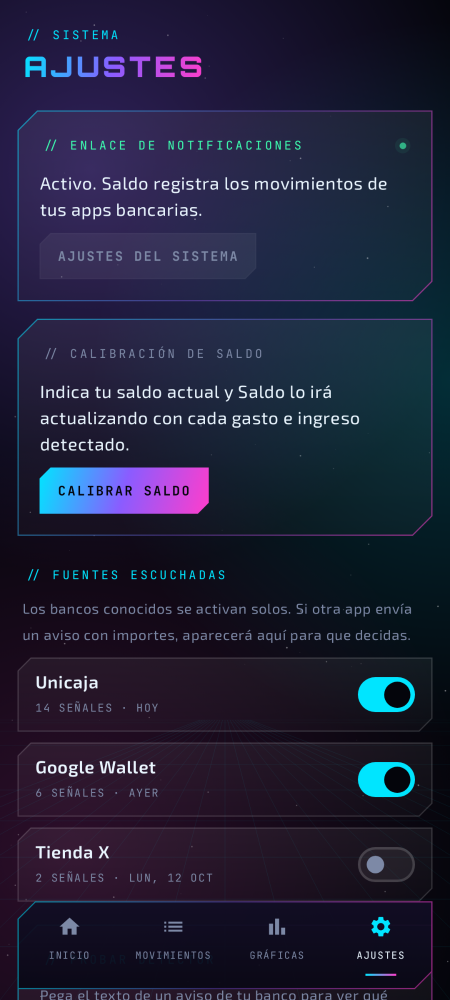
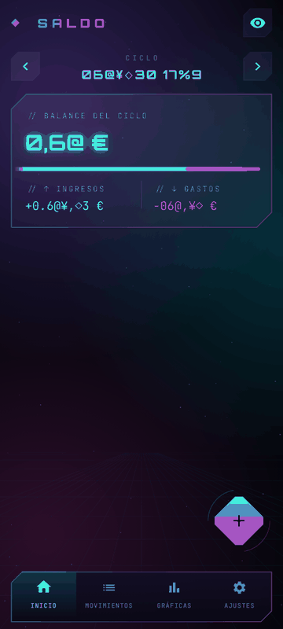

# Saldo · app Android que registra tus gastos leyendo las notificaciones del banco

App nativa (Kotlin + Jetpack Compose) inspirada en ExpenseIA. Lee las notificaciones
de tus apps bancarias, detecta cada pago o ingreso y mantiene tu **saldo actualizado**.

| Inicio | Movimientos | Gráficas | Ajustes |
|---|---|---|---|
|  |  |  |  |

| Arranque | Entrada de Inicio |
|---|---|
|  |  |

### Diseño "holo 2100"

- Fondo vivo: auroras que se desplazan, estrellas que titilan y un horizonte de rejilla en perspectiva.
- Paneles de cristal con esquinas cortadas a 45° y borde iridiscente cian → violeta → magenta.
- "Reactor" de gastos: anillo segmentado con resplandor de neón y marcas que giran.
- Cifras con contador animado y brillo; barra de flujo ingresos/gastos con destello.
- Botón de acción en rombo con pulso de luz y barra de navegación flotante.
- Animaciones: secuencia de arranque (anillo, logo, tecleo y sincronización), transiciones
  entre pestañas con línea de escaneo, entrada escalonada de tarjetas, cifras que se
  "descifran" al ocultar/mostrar o cambiar de mes, glitch ocasional en el logo, destello
  holográfico en las tarjetas, rebote con vibración al pulsar, partículas en el botón ◆,
  indicador deslizante en la barra inferior y avisos holográficos al guardar.
- Reactor interactivo: toca un sector o una categoría para destacarla y ver su detalle.
- Tipografías: Orbitron (titulares y cifras), Exo 2 (texto) y JetBrains Mono (datos),
  todas con licencia SIL Open Font License (ver `licenses/`).

## Qué hace

- **Captura automática**: escucha las notificaciones de BBVA, CaixaBank, imagin, Santander,
  Openbank, ING, Sabadell, Bankinter, EVO, Unicaja, Abanca, Ibercaja, Kutxabank, Cajamar,
  Ruralvía, Pibank, Revolut, N26, Wise, PayPal, Bizum, Google Wallet, Google Pay y Samsung
  Wallet. Detecta importe, gasto/ingreso, comercio y categoría.
- **Sin duplicados con Google Wallet**: si pagas con el móvil, Wallet y tu banco avisan del
  mismo pago; Saldo lo cuenta una sola vez (y aprovecha el saldo si el banco lo indica).
- **Saldo actual**: indicas tu saldo una vez y se actualiza con cada movimiento. Si el banco
  incluye el saldo en la notificación ("Saldo disponible 1.234,56 €"), lo usa directamente.
- **Inicio**: mes con ingresos, gastos y balance; donut de gastos por grupo; últimos movimientos.
- **Movimientos**: lista por días con filtros; toca uno para editarlo, cambiar la categoría o borrarlo.
- **Gráficas**: ingresos vs gastos de los últimos 6 meses y dónde más gastas.
- **Ajustes**: activar el permiso, ajustar saldo, elegir qué apps se escuchan y un
  "probar detector" para pegar el texto de una notificación y ver qué detecta.
- **Privado**: sin permiso de internet. Todo se guarda en una base de datos SQLite del móvil.

## Instalar

1. Descarga `app-release.apk` en el móvil y ábrelo (acepta "instalar apps de origen desconocido").
2. Abre **Saldo → Dar permiso** y activa *Saldo* en "Acceso a notificaciones".
3. Toca **Saldo actual** e indica cuánto tienes ahora en la cuenta.

> En Android 13+ puede que tengas que ir a *Ajustes del sistema → Apps → Saldo → ⋮ →
> Permitir ajustes restringidos* antes de poder activar el acceso a notificaciones
> (pasa con todas las apps instaladas fuera de Play Store).
>
> Unicaja y otros bancos solo envían avisos de compras si los activas en su app
> (en Unicaja: *Perfil → Notificaciones / Alertas*).
>
> Algunos fabricantes (Xiaomi, Samsung, Huawei) cierran apps en segundo plano: excluye
> Saldo de la optimización de batería para que no se pierda ninguna notificación.

## Compilar

Requiere JDK 17+ y el Android SDK (API 35).

```bash
cd apps/saldo-android
./gradlew assembleRelease        # APK en app/build/outputs/apk/release/
./gradlew testDebugUnitTest      # tests del detector de notificaciones
```

## Estructura

```
app/src/main/java/com/byluso/saldo/
├── parser/NotificationParser.kt   # Extrae importe, tipo, comercio y saldo del texto
├── parser/Categories.kt           # Categorías y palabras clave (Mercadona → Comida…)
├── service/BankNotificationListener.kt  # NotificationListenerService
├── data/Repository.kt             # SQLite + StateFlow, deduplicación
├── data/Models.kt                 # Movement, SourceApp, cálculo del saldo
├── data/BankApps.kt               # Paquetes de bancos conocidos
└── ui/                            # Pantallas Compose
```

Si tu banco usa un formato que no se detecta, pega el texto en *Ajustes → Probar detector*
y añade el caso a `NotificationParserTest.kt`.
